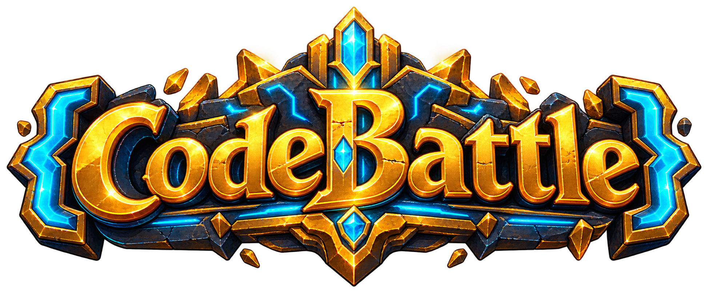
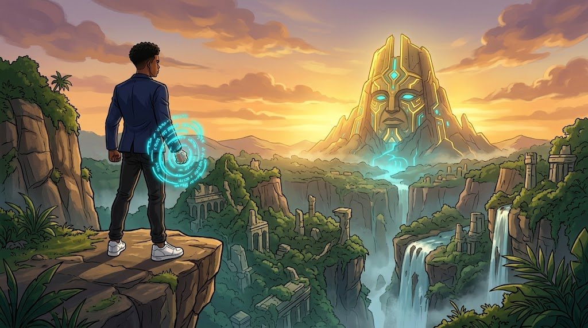
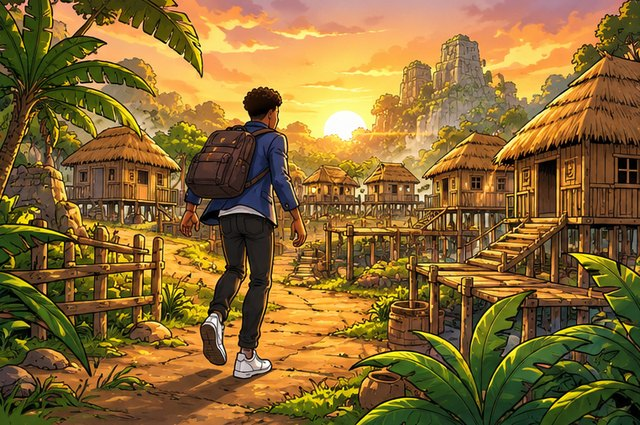
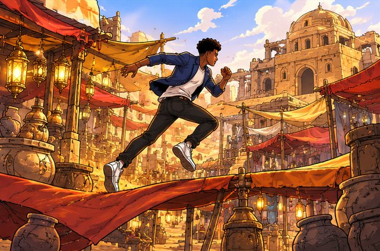
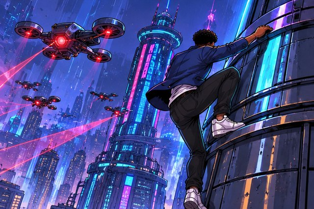
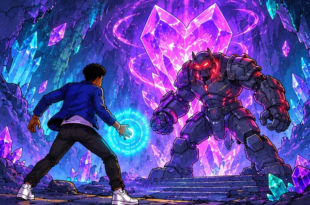

<div align="center">



# CodeBattle — la quête du Grand Trésor

**Jeu d'aventure 2D en JavaScript pur : parkour, infiltration et combat, dans l'esprit d'*Assassin's Creed Chronicles*.**
Jouable dans le navigateur, installable en PWA, pensé pour Android en paysage.




</div>

---

## L'histoire

**Parfait** est un développeur qui maîtrise le *Code Override* : il compile l'énergie en orbes cyan et réécrit le monde autour de lui.
De la jungle jusqu'au coffre-fort doré, il traverse **5 mondes et 20 niveaux** pour retrouver le **Grand Trésor**, gardé par **KERNEL**, le boss final.

Chaque niveau cache un coffre au bout du parcours : on l'ouvre, on lève le trésor, on passe au suivant.

## Ce qu'il y a dans le jeu

| | |
|---|---|
| 🌍 **5 mondes, 20 niveaux** | Ruines de la Jungle, Temple du Désert, Néo-Ville, Cavernes de Cristal, Coffre-Fort Doré |
| 🥷 **Infiltration** | Mode furtif, champ de vision des gardes, éliminations silencieuses par derrière |
| 🥊 **Combat** | Coups de poing et de pied en combo, balayage, garde, Syntax Blast (attaque d'énergie) |
| 🏃 **Parkour** | Plateformes hautes et basses, ravins, caisses et barils explosifs |
| 👾 **Ennemis** | Bug Guard, Glitch Sniper (arbalète), Sentinel Drone (laser), Firewall Brute, KERNEL |
| 🔥 **Points de sauvegarde** | Des torches tout au long des niveaux : on y revient après une chute |
| 🎚️ **3 difficultés** | Facile, Normal, Difficile : vie et dégâts des ennemis, longueur des niveaux |
| 🎬 **Cinématiques** | Intro et transitions entre les mondes, avec bouton « Passer » |
| 🎵 **Son** | Une musique par monde, musique de boss, pas synchronisés sur la course, bruitages de combat |
| 💾 **Sauvegarde** | Progression, étoiles et pièces enregistrées dans le navigateur |
| 📱 **Mobile & PWA** | Boutons tactiles, plein écran paysage, fonctionne hors ligne |

<div align="center">
   
</div>

## Jouer en local

Aucune installation, aucune dépendance : il suffit de **Node.js** pour le petit serveur de développement.

```bash
git clone https://github.com/Docteur-Parfait/codebattle.git
cd codebattle
node tools/serve.js 8091
```

Puis ouvre **http://localhost:8091**.

> Les modules ES et le service worker ne fonctionnent pas en ouvrant `index.html` directement (`file://`) : passe par un serveur.
> N'importe quel serveur statique convient (`npx serve`, `python -m http.server`…), mais `tools/serve.js` gère aussi les requêtes HTTP *range* utilisées par les vidéos.

## Commandes

| Action | Clavier | Mobile |
|---|---|---|
| Se déplacer | `←` `→` ou `Q`/`A` `D` | Joystick |
| Sauter | `Espace` | Bouton saut |
| Coup de poing (combo) | `J` | 👊 |
| Coup de pied (`↓` + `K` : balayage) | `K` | 🦵 |
| Syntax Blast | `L` | ⚡ |
| Garde | `I` ou `Maj` | 🛡️ |
| Mode furtif | `C` | 🥷 |
| Ouvrir le coffre | `E` ou `Entrée` | ✋ |
| Pause / menu | `Échap` ou `P` | Bouton en haut à droite |

**Astuce :** en mode furtif, approche un garde par derrière et frappe : élimination silencieuse.

## Structure du projet

```
codebattle/
├── index.html            # écrans (titre, carte, pause, résultats) + canvas
├── css/style.css
├── js/
│   ├── main.js           # boucle, écrans, navigation, vidéos
│   ├── game.js           # monde : physique, caméra, combat, rendu, HUD
│   ├── entities.js       # Parfait et les ennemis (IA, attaques, animations)
│   ├── level.js          # génération des niveaux (sol, plateformes, ennemis…)
│   ├── sprite.js         # animateur de sprites
│   ├── animdata.js       # durées image par image des animations
│   ├── assets.js         # chargement des atlas, images et données
│   ├── audio.js          # musique et bruitages (WebAudio)
│   ├── input.js          # clavier + commandes tactiles
│   ├── difficulty.js     # préréglages de difficulté
│   └── save.js           # sauvegarde localStorage
├── assets/
│   ├── sprites/          # planches de sprites sources
│   ├── build/            # atlas générés (ne pas modifier à la main)
│   ├── environment/      # décors, tuiles, objets, effets, interface
│   ├── levels/           # levels.json + miniatures des niveaux
│   ├── cinematics/       # vidéos et images clés
│   └── audio/            # musiques et bruitages
├── tools/
│   ├── serve.js          # serveur de développement
│   ├── build_assets.py   # planches de sprites → atlas
│   ├── build_env.py      # planches de décor → env.json
│   ├── extract_blobs.py  # repère les objets d'une planche transparente
│   └── animview.html     # visionneuse d'animations
├── manifest.webmanifest
└── sw.js                 # service worker (cache hors ligne)
```

### Reconstruire les atlas

Après avoir modifié une planche dans `assets/sprites/` ou un décor dans `assets/environment/` :

```bash
pip install pillow numpy scipy
python -I tools/build_assets.py
python -I tools/build_env.py
```

Pour vérifier une animation à la vitesse du jeu :
`http://localhost:8091/tools/animview.html?char=parfait&anims=idle,walk,run`

### Mode debug

`http://localhost:8091/?debug` expose `window.__cb` dans la console :
`__cb.startLevel(5)` lance un niveau, `__cb.game()` donne accès à l'état du jeu.

## Contribuer

Les contributions sont les bienvenues : correctifs, nouveaux ennemis, niveaux, sons, traductions, accessibilité…
Lis le **[guide de contribution](CONTRIBUTING.md)** avant d'ouvrir une *pull request*.

## Crédits

- **Conception, développement et direction artistique :** Parfait Toke ([@Docteur-Parfait](https://github.com/Docteur-Parfait))
- **Illustrations et animations :** générées par IA à partir des esquisses et références de l'auteur, puis découpées et assemblées par les outils de `tools/`
- **Musiques et bruitages :** générés avec ElevenLabs ; les sons manquants sont synthétisés en direct par `js/audio.js`

## Licence

- **Code** (`js/`, `css/`, `tools/`, `index.html`, `sw.js`) : licence [MIT](LICENSE).
- **Ressources** (`assets/` : personnages, décors, musiques, vidéos) et le personnage de Parfait, qui représente l'auteur : © Parfait Toke, tous droits réservés.
  Tu peux les utiliser pour jouer, tester et contribuer à ce projet, mais pas les réutiliser dans un autre projet sans autorisation.
